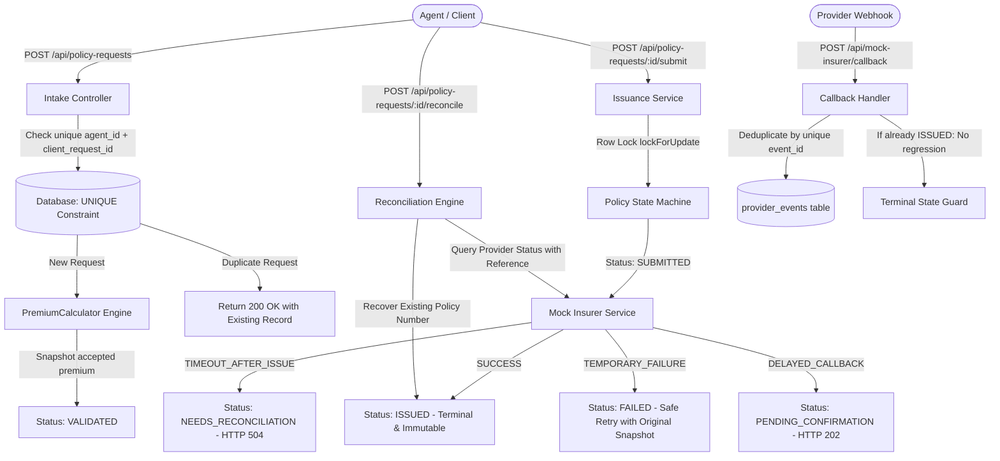

# PolicyFlow: Fault-Tolerant Insurance Issuance & Reconciliation Engine

> **TrippersShield Campus Engineering Practical Assessment**  
> A resilient, failure-oriented travel-insurance intake, issuance, and reconciliation engine built with **PHP 8.2+** and **Laravel 11**, designed to withstand unreliable upstream providers, network timeouts, duplicate intake submissions, and repeated webhook deliveries.

---

## Table of Contents
1. [Core Architectural Decisions](#core-architectural-decisions)
2. [State Machine & Transition Rules](#state-machine--transition-rules)
3. [Reliability Engineering Highlights](#reliability-engineering-highlights)
4. [Reliability Verification Evidence](#reliability-verification-evidence)
5. [Controllable Mock Insurer & Failure Demo](#controllable-mock-insurer--failure-demo)
6. [API Contract & Specifications](#api-contract--specifications)
7. [Local Setup & Testing Guide](#local-setup--testing-guide)
8. [Known Limitations & Production Considerations](#known-limitations--production-considerations)

---

## Core Architectural Decisions



### 1. Database-Level Idempotency (`(agent_id, client_request_id)`)
Application-level `if (!exists)` checks are vulnerable to race conditions under concurrent submissions. PolicyFlow enforces a composite unique constraint at the database schema level:
```sql
UNIQUE KEY unique_agent_client_request (agent_id, client_request_id)
```
When concurrent requests arrive simultaneously, the database serializes them. If a race occurs, the transaction catches SQL constraint violation (`23000`), resolves the race gracefully, and returns the existing entity with **HTTP 200 OK** (new entities return **HTTP 201 Created**).

### 2. Isolation of Network I/O from Database Transactions
In enterprise systems, holding open database transactions across slow or timeout-prone external HTTP network calls exhausts database connection pools and causes lock thrashing. PolicyFlow isolates the provider call:
1. Fast transaction: acquires row-level lock (`lockForUpdate`), advances state to `SUBMITTED`, logs attempt, and commits.
2. External call: invokes the mock insurer outside the open transaction.
3. Outcome transaction: records the outcome (`ISSUED`, `NEEDS_RECONCILIATION`, or `FAILED`) and persists audit entries without being rolled back by HTTP exceptions.

### 3. Immutable Premium Snapshot
Insurance regulations prohibit price alterations upon retry. Once a policy request is priced, `premium_amount`, `currency`, and `travel_days` are locked into an immutable snapshot. Any subsequent submission attempt or safe retry strictly utilizes this accepted snapshot.

### 4. Reconciliation: A Timeout is an Uncertain Outcome
A network timeout or HTTP 504 does not prove the insurer failed to issue a policy. The insurer may have committed the policy to its ledger while the network connection dropped. Blindly retrying would generate duplicate policies and charge customers twice. Instead, PolicyFlow:
- Marks the request as `NEEDS_RECONCILIATION`.
- Provides an automated reconciliation endpoint (`POST /api/policy-requests/{id}/reconcile`) that queries the provider using the stable reference to recover the original policy number.

### 5. Terminal State Immutability
`ISSUED` is strictly terminal. Any subsequent attempt to re-submit or regress an issued policy (whether via API call or duplicate webhook callback) is rejected with **HTTP 409 Conflict**, preserving system integrity.

---

## State Machine & Transition Rules

PolicyFlow implements an explicit state machine with audit history logging:

| From State | Allowed To States | Description |
| :--- | :--- | :--- |
| **`RECEIVED`** | `VALIDATED`, `FAILED` | Fresh intake validated and priced |
| **`VALIDATED`** | `SUBMITTED`, `FAILED` | Snapshot premium saved; ready for submission |
| **`SUBMITTED`** | `ISSUED`, `PENDING_CONFIRMATION`, `NEEDS_RECONCILIATION`, `FAILED` | In-flight request dispatched to insurer |
| **`PENDING_CONFIRMATION`**| `ISSUED`, `FAILED`, `NEEDS_RECONCILIATION` | Awaiting asynchronous callback from provider |
| **`NEEDS_RECONCILIATION`**| `ISSUED`, `FAILED` | Timeout encountered; awaiting status recovery |
| **`FAILED`** | `SUBMITTED` | Safe controlled retry using immutable snapshot |
| **`ISSUED`** | *(None - Terminal)* | **Immutable terminal state. All regressions rejected (409 Conflict)** |

---

## Reliability Engineering Highlights

### Case A: Duplicate Intake Protection
- Submitting the same `agent_id` + `client_request_id` returns the existing policy request with `200 OK`.
- Database contains exactly one record under the unique index.
- If an agent tampers with parameters (such as trying to change the plan or sum insured), the existing snapshot is returned untouched.

### Case B: Timeout After Successful Issuance
- The mock insurer creates the policy internally, but the HTTP response times out.
- The request transitions to `NEEDS_RECONCILIATION` (HTTP 504).
- The `/reconcile` endpoint queries the provider, recovers the existing `policy_number`, and moves to `ISSUED` without re-submitting.

### Duplicate Callback Deduplication
- Webhooks contain a unique `event_id`.
- The `provider_events` table enforces a `UNIQUE(event_id)` constraint.
- Repeated delivery returns `200 OK` with `status: "DUPLICATE_IGNORED"`. State remains intact.

### Operations Observability Endpoint
- `GET /api/operations/summary` reports real-time metrics:
  - Total requests, issued count, pending confirmations, failed requests, requests needing reconciliation, and total issued premium in INR.

---

## Reliability Verification Evidence

The following verifiable tests have been executed via `php artisan test`:

| Verification Case | Expected Behavior | Actual Automated Test Evidence | Status |
| :--- | :--- | :--- | :---: |
| **20 Repeated Intake Requests** | Exactly 1 logical database record; HTTP 200 on repeats | `DuplicateIntakeTest::test_twenty_repeated_intakes_produce_single_database_record` (1 DB row) | **PASSED** |
| **Tampered Duplicate Intake** | Preserves original accepted immutable snapshot | `DuplicateIntakeTest::test_repeated_intake_preserves_immutable_pricing_snapshot` | **PASSED** |
| **Timeout After Issuance** | Transitions to `NEEDS_RECONCILIATION`; `/reconcile` recovers policy | `TimeoutReconciliationTest::test_timeout_after_issuance_transitions_to_needs_reconciliation` | **PASSED** |
| **Duplicate Webhook Delivery** | First event applies; subsequent identical events return `DUPLICATE_IGNORED` | `DuplicateCallbackTest::test_duplicate_callbacks_are_idempotently_deduplicated` | **PASSED** |
| **Attempt to Regress ISSUED** | Rejected with HTTP 409 Conflict; state remains `ISSUED` | `StateMachineTerminalIssuedTest::test_attempt_to_resubmit_an_issued_policy_returns_409_conflict` | **PASSED** |
| **Temporary Failure Retry** | Retries `FAILED` request to `ISSUED` with original premium snapshot | `TemporaryFailureRetryTest::test_temporary_failure_allows_safe_retry_with_original_premium_snapshot` | **PASSED** |
| **Specification Formula Check** | PLUS plan, 5 days, age 28, international, ₹300k = ₹225.00 | `PremiumCalculatorTest::test_calculates_exact_reference_example_from_specification` | **PASSED** |

---

## Controllable Mock Insurer & Failure Demo

Reviewers can trigger deterministic behaviors via the `X-Mock-Scenario` header or request body parameter:

| Scenario | Simulated Behavior | Expected Result |
| :--- | :--- | :--- |
| `SUCCESS` | Normal issuance | HTTP 200; generates `policy_number`; state `ISSUED` |
| `TEMPORARY_FAILURE` | Transient 503 error | HTTP 503; state `FAILED`; safe retry possible |
| `TIMEOUT_AFTER_ISSUE` | Creates policy, socket times out | HTTP 504; state `NEEDS_RECONCILIATION` |
| `DELAYED_CALLBACK` | Queues async issuance | HTTP 202; state `PENDING_CONFIRMATION` |

### Step-by-Step Failure & Recovery Demo (Case B)

```bash
# 1. Create a policy intake
curl -X POST http://localhost:8000/api/policy-requests \
  -H "Content-Type: application/json" \
  -d '{
    "client_request_id": "DEMO-TIMEOUT-001",
    "agent_id": "AGENT-01",
    "customer_name": "Demo Traveler",
    "date_of_birth": "1990-01-01",
    "destination": "DOMESTIC",
    "trip_start": "2026-11-01",
    "trip_end": "2026-11-05",
    "plan_code": "PLUS",
    "sum_insured": 300000
  }'

# (Copy the returned id as $POLICY_ID)

# 2. Trigger TIMEOUT_AFTER_ISSUE scenario
curl -i -X POST http://localhost:8000/api/policy-requests/$POLICY_ID/submit \
  -H "X-Mock-Scenario: TIMEOUT_AFTER_ISSUE"

# Observe: HTTP 504 Gateway Timeout returned
# State is now: "NEEDS_RECONCILIATION"

# 3. Inspect mock insurer internal ledger (proves insurer issued policy)
curl -X GET http://localhost:8000/api/mock-insurer/policies/$PROVIDER_REF

# 4. Reconcile the request
curl -i -X POST http://localhost:8000/api/policy-requests/$POLICY_ID/reconcile

# Observe: HTTP 200 OK
# Status becomes: "ISSUED" with the recovered policy number
# No duplicate policy is generated!
```

---

## API Contract & Specifications

### 1. `POST /api/policy-requests`
- **Purpose**: Intake request. Validates fields, calculates deterministic pricing snapshot, enforces database uniqueness.
- **Status Codes**:
  - `201 Created`: Newly created policy request.
  - `200 OK`: Repeated request with same `(agent_id, client_request_id)`.
  - `422 Unprocessable Entity`: Validation failure.

### 2. `GET /api/policy-requests/{id}`
- **Purpose**: Retrieve policy details, snapshot, provider references, and complete audit history (`state_history`, `attempts`).
- **Status Codes**: `200 OK`, `404 Not Found`.

### 3. `POST /api/policy-requests/{id}/submit`
- **Purpose**: Dispatches policy to insurer under row-level lock. Supports `X-Mock-Scenario` header.
- **Status Codes**:
  - `200 OK`: Successfully issued (`status: ISSUED`).
  - `202 Accepted`: Asynchronous processing (`status: PENDING_CONFIRMATION`).
  - `504 Gateway Timeout`: Timeout occurred (`status: NEEDS_RECONCILIATION`).
  - `503 Service Unavailable`: Temporary failure (`status: FAILED`).
  - `409 Conflict`: Attempted regression or resubmission of already issued policy.

### 4. `POST /api/policy-requests/{id}/reconcile`
- **Purpose**: Queries provider status for ambiguous or timed-out requests and recovers policy numbers without re-issuing.
- **Status Codes**: `200 OK`.

### 5. `POST /api/mock-insurer/callback`
- **Purpose**: Asynchronous provider webhook receiver. Idempotently deduplicates by `event_id`.
- **Status Codes**: `200 OK`.

### 6. `GET /api/operations/summary`
- **Purpose**: Read-only operational metrics dashboard summary.
- **Status Codes**: `200 OK`.

### 7. `GET /api/policy-requests`
- **Purpose**: Paginated list of policy requests with status and agent filters.
- **Status Codes**: `200 OK`.

---

## Local Setup & Testing Guide

### Prerequisites
- PHP 8.2 or higher (with `pdo_sqlite` or `pdo_mysql`, `bcmath`, `mbstring`)
- Composer 2.x

### Setup Commands
```bash
# 1. Clone repository
git clone <repo-url> policyflow
cd policyflow

# 2. Install dependencies
composer install

# 3. Environment configuration
cp .env.example .env
php artisan key:generate

# 4. Run migrations
php artisan migrate

# 5. Execute automated test suite
php artisan test
```

### Running the Local Server & Evaluation HTTP File
```bash
# Start local API server
php artisan serve --port=8000
```
Open [`examples/policy-requests.http`](examples/policy-requests.http) in VS Code (with REST Client extension) or JetBrains IDE to execute all requests with one click.

---

## Known Limitations & Production Considerations
1. **Queue Workers**: In high-throughput production, asynchronous callbacks and background reconciliation polling jobs would run on distributed Redis workers (`php artisan queue:work`) with exponential retry backoff and dead-letter queues.
2. **Distributed Locks**: For multi-node deployments across separate database read-replicas, distributed mutex locks (e.g. Redis Redlock) would complement database row locks (`lockForUpdate`).
3. **Database Portability**: Tested on SQLite for zero-dependency local review; schema migrations use standard SQL types and composite keys fully compatible with MySQL 8+ and PostgreSQL 14+.
